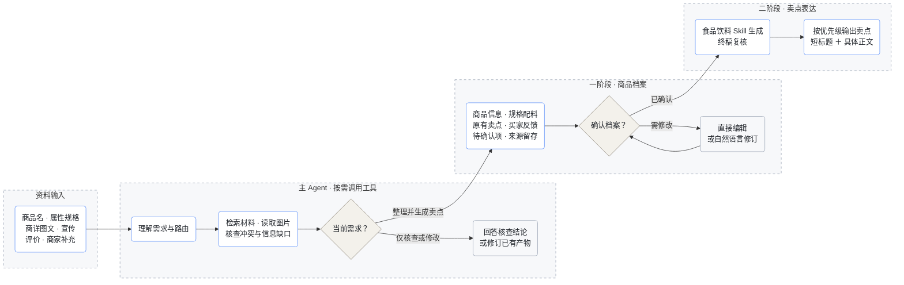
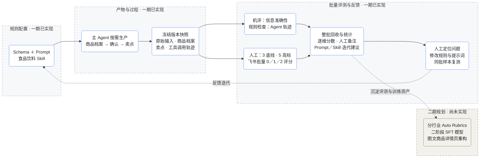

<title>见微｜商品卖点提炼 Agent：业务方案、14商品试跑与评测闭环</title>

一期交付说明 · 2026年10月28日。以14条线上真实食品饮料商品试跑，展示规则、生产、确认、评测与迭代的完整设计；二期规划与已实现能力分开说明。

# 1 项目背景与目标

货架场景中，消费者主要依靠商品详情页完成判断。任务方提出的业务痛点是：商家已有属性、规格和商详素材，但信息零散、重点不清，缺少直播中对体验、使用方式和场景的解释，商家重新整理文案的成本也较高。这里把“直播到货架的表达差距”作为待改善的问题，而不把直播转化更高直接归因于文案：价格、流量、人群、主播信任与促销同样影响转化。

见微的目标是将商家已有信息整理成可确认、可修订的商品档案，再生成有依据、覆盖充分、易读且具体的卖点文案。它既支持完整生成，也支持只核查冲突、补充信息、修改档案或局部改写。当前交付的是辅助商家创作和复核的Agent，不替代商品标签审查，也没有宣称已验证线上转化提升。

成功标准分三层：能否正确收集和隔离冲突事实；能否形成有购买价值、标题明确、正文具体的卖点；能否通过可追溯评测推动下一版规则。线上转化效果需要后续随机A/B实验验证，本轮以离线产物和可运行产品为验收对象。

# 2 为什么先做食品饮料

本期选择食品饮料，首先是数据可得性：实际取得的14条商品已有较完整的属性、规格、详情图、宣传和评价，能够以真实数据完成输入到输出验证。其次，这个行业有较多能被文字解释的购买理由，例如原料、口感、工艺、烹饪便利、包装与食用场景；原详情图已写有卖点，任务的增量是重新组织、补足解释、去重并提升表达，而非从没有信息的图片中凭空发明卖点。

| 比较维度 | 食品饮料 | 服饰 |
|-|-|-|
| 当前可用数据 | 已有14条较完整真实样本，试跑成本低 | 本轮没有同等完整样本 |
| 文字可贡献的增量 | 解释原料/体验/烹饪与包装便利 | 解释版型/穿搭/触感和适用场景 |
| 主要事实边界 | 配料、净含量、口味、保质期、营养与功效声称 | 尺码、面料、版型、体感和模特差异 |
| 本期选择理由 | 能集中验证图文整理、跨SKU冲突与表达质量 | 同样有价值，留待数据齐全后扩展 |

这不是食品饮料在所有行业中价值最高的结论，而是资源条件、可验证性和表达空间共同决定的首期切入。子类覆盖零食糕点、冷冻/需加工食品、粮谷干货、茶与饮料，足以暴露不同表达与证据问题，但14条不能代表整个行业。通用评测维度保持跨行业可复用，行业边界放在Skill中。

# 3 数据与任务范围

数据来自任务协作方提供的线上商品表，保留原商品ID、行号和来源链接。去掉不符合要求的记录后，当前固定为14条商品，共776份材料片段，其中581条文本、195张商品/商详图片片段。长图拆片用于实际图片读取，这195张是模型输入片段数，不是195个独立商品或原始详情页。

[原始14商品来源表](https://bytedance.larkoffice.com/wiki/AiW6wP6sNikPQDkyb7lcDJYUnmd?sheet=o0mF3B)。原任务要求不少于20个商品；任务方在聊天中明确允许按可取得样本缩减。本次据此交付14个真实商品，不补造6个商品，也不把132条卖点算成132个样本。

输入支持商品名称、属性/配料、规格、商详文字及图片、已有宣传、买家评价、商家补充；附件解析支持常见图片、文本、CSV/JSON、PDF/DOCX中的文字。直播口播本轮未取得，因此没有mock口播或宣称使用过直播数据。PDF/DOCX中的嵌图不是完整多模态解析，关键图片建议独立上传。旧AI摘要只作历史材料，不作为事实证明。

每份材料有source_id、类型、来源角色、定位与原文/图片路径。图片由视觉请求实际读取；模型无法据纯文字属性识别的视觉证据，不会假装来自文本。材料再多也按批次覆盖，不用静默截断替代完整读取。

# 4 产品逻辑与Agent设计

用户端以对话为主，选择已有样例或上传附件后可描述目标。主Agent选择工具读取、检索、核查或建档，不要求每个请求都走完两阶段：例如“有无冲突”直接输出核查报告，“改这一条”只执行必要修改。工具调用有边界、出错可报告，不展示内部思考；前端展示公开处理步骤和流式回复。

首次要求生成时，先展示一阶段商品档案。档案可以在右侧可收起面板查看、编辑，也可通过自然语言补充和修订；新增材料或修改会使旧确认失效。用户确认当前版本后，再生成二阶段卖点。待确认项允许保留，生成时避开争议内容，不要求商家补齐所有资料才能开始。

配置工作台可改Schema、食品饮料Skill、提示词和模型连接；评测是独立一级入口。常用交互已包含聊天收藏/置顶/归档、复制、重新生成、Markdown、附件、档案版本及导出。评测中心批量操作保留滚动位置，避免操作后回到顶部。下图画的是常见生成路径，主Agent仍按用户意图动态决定工具，不是硬编码所有请求都照走的Workflow。

# 5 核心策略：规则、档案与卖点生产

| 环节 | 输入/输出 | 策略与边界 |
|-|-|-|
| 规则层 | Schema、通用规则、行业Skill与Prompt | 规则与模型解耦，可配置；对核心字段保留运行合同，防止随意改坏接口 |
| 一阶段 | 五块：商品信息、规格配料、原有卖点、买家反馈、待确认项 | 摘要精简但覆盖重要材料；来源、材料与配置版本留在后台；不同SKU不能混用 |
| 确认层 | 商家可见档案与当前版本 | 确认的是该版本；编辑或补充后重新确认，防止基于旧事实生成 |
| 二阶段 | selling_points数组；每条text与priority | text默认短标题｜正文；不限制条数，覆盖独立有效理由，不能拆碎凑数 |
| 终稿复核 | 档案、初稿、用户要求 | 检查新增性状/承诺、重复与漏点，再交付业务JSON |

一阶段不是把商详宣传原样洗成“确定事实”。它区分客观属性、原有描述、个体反馈与待确认：配料和克重须保留适用规格，主观口感不得升级为检测、营养或认证；无法确认或互斥的信息留在待确认区。程序检查结构、来源ID、版本及可证明的约束，语义正确性仍需机评与人工复核，不能保证模型从不出错。

二阶段先选点后表达：将具体特征转化成消费者理解的价值，再用标题概括、正文补充细节或场景。比喻只是可选修辞，不能用来偷偷新增爆浆、拉丝、无添加或减肥等未证实事实。冷冻食品的“开袋即用”不能变成“开袋即食”；标签中的标识不自动变成认证；促销、年份、价格与服务承诺需要当前范围，不能长期泛化。

优先级是编辑排序，1最高，不是转化率预测或数学打分。先排除缺证/冲突声称，再综合用户关注点、购买决策价值、商品具体差异和证据充分性安排；核心体验与关键差异通常优先于一般规格或物流。相近价值按自然阅读顺序，用户特别关注便携或送礼时可以调整。

两阶段也为未来模型训练留出稳定接口：一阶段保持可追溯的输入档案，二阶段可替换为经过标注与验证的SFT生成器。当前实际使用的是DeepSeek与可配置Prompt/Skill，没有训练或部署SFT模型。

# 6 评测闭环：维度、方法、评测集与迭代

评什么：将事实底线、文案质量和Agent轨迹分开。底线三类按事实、广告表达、竞品关系划分；同一个根因优先记在最直接的维度，独立问题才能分别扣分。质量先看选点，再看标题、正文和整组表达。底线问题不能用高质量分抵消。

| 底线维度 | 定义 | 0 / 1 / 2 |
|-|-|-|
| 事实准确 | 只核对“说的事实是否成立”：数值、单位、配料、工艺、SKU/套装/条件范围、评价归因均须有证据且不冲突；不因原文存在就认为事实正确。 | 0 明确问题；1 待复核；2 未发现该类问题（不是法律认证） |
| 广告表述合规 | 只核对“这种说法是否允许、是否过度承诺”：绝对化或保证性表达、医疗/功效暗示及行业广告限制；以语境和适用规则判断，不能机械按关键词定违法。事实真伪归事实项，竞品贬损归竞品项。 | 0 明确问题；1 待复核；2 未发现该类问题（不是法律认证） |
| 不贬损竞品 | 只核对“如何对待其他经营者及其商品”：不嘲讽、污名化、贬低具体或可识别的竞品；中性事实比较不因提到竞品直接扣分，其数据真伪另归事实项。 | 0 明确问题；1 待复核；2 未发现该类问题（不是法律认证） |

| 质量维度 | 权重 | 0分 | 1分 | 2分 |
|-|-|-|-|-|
| 卖点覆盖完整性 | 20% | 遗漏最核心的可用卖点，或大部分条目在重复同一信息。 | 核心卖点基本覆盖，但漏掉一个重要独立角度，或有明显重复。 | 重要且有依据的独立角度覆盖充分，无显著漏点或同义凑数。 |
| 购买价值相关性 | 25% | 主要是无关背景、泛好评、平台热度或通用赞美，看不出为何值得选。 | 有一部分购买理由，但混入较多弱相关或低价值信息。 | 主要卖点与商品使用、体验或用户明确诉求紧密相关，能帮助购买判断。 |
| 标题表达质量 | 20% | 标题空洞、含混、难懂、只喊口号，或与对应正文重点不一致。 | 能够概括卖点，但平淡、过长、雷同，或重点不够突出。 | 快速浏览即可理解具体好处或体验，精炼有记忆点，与正文紧密对应。 |
| 正文表达质量 | 25% | 仅把标题换词复述、堆空泛形容词，或展开与卖点无关。 | 补充了一些有效信息，但解释单薄、生硬或同质化，尚需编辑。 | 展开有新增信息，理由连贯、细节具体，必要时用自然的场景或感官表达；简短直接的充分说明也可得2分。 |
| 整体可读性 | 10% | 主题混杂、重复堆砌、长句难读或出现大量内部分析话术，难以直接使用。 | 基本能读，但有局部冗长、跳跃、格式不一致或必要限定不够清楚。 | 一条聚焦一个重点，整组层次清楚、语气自然、便于扫读，限定和输出形式符合用户要求。 |

质量加权分=Σ(维度得分×权重)/Σ权重，范围0—2；三项底线另列，不混进质量总分。空白是未评，不是0分。只有完整评分写入全局质量记录，批次内部分填写按各维度实际n展示，不能把样本不一样的均分直接比较。

怎么评：机评把档案与卖点中的断言回到原始材料，返回supported、contradicted、insufficient及来源原文。引用无法通过原文/来源检查时降为证据不足；机评本身也可能误判，不能当真值。人工在飞书表中逐商品给三项底线和五项质量打0/1/2分，填写逐维备注与评审人；事实与合规争议应优先复核原始证据。建议先双人独立评同一小批，再讨论分歧校准，尚未声称本轮已完成双人标注。

用什么评：本轮14条组成固定开发回归集，保存原始输入、一阶段、二阶段、配置与产物版本。覆盖多口味/混装、属性和图文冲突、需加工边界、健康功效敏感描述、图片信息较多/较少、评价与旧AI摘要等情况。因为这些样本参与过规则打磨，它们不是独立盲测集。后续需新增未见商品与改写/注入/缺失证据的挑战集，再按子类和难度分层；同商品多个SKU或版本不能随意拆到训练与测试两边。

如何执行：一次选择多个已完成Session并冻结批次，导出飞书电子表格。前三列是原始信息、一阶段依据、二阶段卖点，之后是各维度下拉评分和备注；原始资料页保留全文与图片源定位，标准页给评分定义。回收时校验样本ID、版本与前三列产物，不把被改写的产物和旧评分混在一起。批次评分可保存、统计分布、均分、缺评n及低分备注，并给出规则/Prompt/Skill排查建议。

评整体Agent时，人工看意图与任务完成、工具选择与证据使用、确认与多轮协作、执行效率、错误处理与结果诚实五项。现有规则检查生成前是否确认、同轮同参数过多重复、工具失败与恢复情况；工具成功率不等于答对，少调用也不天然更好。只使用公开工具轨迹，不要求或保存模型内部思考。本次离线批量直接复用建档/生成内核，不冒充14段真人多轮交互轨迹；轨迹评测需要另选真实交互Session。

如何驱动迭代：先把低分逐条映射到原文和输出位置，判断是抽取、范围、选点、表达、路由还是确认问题；事实错优先修一阶段和校验，选点漏/重复修Skill，标题或正文弱修生成及终稿Prompt，工具循环修主Agent。只改与问题相关部分，再用同一冻结输入对比新旧版本，复查底线和未改维度，留下回归记录。当前界面给建议，修改由人确认，不自动把评测意见写回Prompt。

# 7 本轮14商品试跑与交付物

[打开14商品结果与人工评审表](https://bytedance.larkoffice.com/sheets/MwiWseJ4PhGMNhtbeMMcevSMnth)：人工评审页按商品逐行列原始信息、一阶段档案、二阶段卖点及各维度评分/备注；另有评分标准、原始资料、机评逐条核查三个页签。图片通过原表链接与来源定位查看，仓库也保留拆片文件。结果是生成草稿，不代表人工审核通过。

本轮当前版本重新跑完14/14商品，生成132条卖点；每条保留优先级，所有14份档案与JSON均保存。此处“14/14”仅表示生成任务完成，不表示事实或文案质量全通过。批量运行使用用户本轮明确授权统一生成，保留该授权说明，未伪装成逐条商家确认，也未将历史人工示例混作本轮模型结果。

| 商品 | 材料片段 | 卖点条数 | 机评有支持 | 机评疑似冲突 | 机评证据不足 |
|-|-|-|-|-|-|
| 矮子馅饼蜂蜜花生麻花甜香酥脆传统糕点休闲解馋办公室零食点心 | 64 | 6 | 50 | 0 | 15 |
| 【到手3条】徽渔桂臭鳜鱼带包装0.6-1斤/条安徽特产正宗三去臭桂鱼 | 42 | 10 | 17 | 0 | 25 |
| 【拍一发8袋】清真鲜牛肉羊肉蒸煮煎炸水饺皮薄馅大夜宵早餐面点 | 63 | 8 | 38 | 1 | 22 |
| 【纯手工现做现发】江西特产鲜虾饼虾巴花生巴香酥脆休闲零食解馋 | 63 | 9 | 49 | 0 | 29 |
| 【618超值购85袋赠2袋试吃】烧仙草免煮白凉粉双皮奶果冻小零食饮料 | 38 | 10 | 41 | 0 | 27 |
| 拾兄弟东北黑米当季新米优质黑大米粗粮米饭五谷杂粮粥饭健康 | 77 | 13 | 40 | 0 | 21 |
| 【焕新季·暑期大促】云南白背毛木耳丝干货免切 螺蛳粉炒菜火锅凉拌 | 62 | 8 | 22 | 0 | 27 |
| 羽晨妈妈新鲜墨鱼仔鲜甜脆嫩足斤足两去皮去脏乌贼火锅烧烤食材 | 60 | 8 | 47 | 0 | 7 |
| 拾兄弟正宗5斤东北大碴粥大碴子粥芸豆玉米碴五谷杂粮健康粗粮 | 61 | 10 | 34 | 0 | 18 |
| 益生元枇杷山楂糕鲜果打浆酸甜软糯大人小孩健康营养解馋小零食 | 37 | 7 | 29 | 0 | 15 |
| 渝烧白【3碗老字号】手工制作五花肉烧白扣肉夹沙扣肉粉蒸扣肉 | 71 | 12 | 59 | 1 | 20 |
| 曲奇四重奏蝴蝶酥香港进口曲奇下午茶糕点礼盒零食饼干伴手礼七夕 | 30 | 13 | 38 | 0 | 11 |
| 茶嫂当家冲天香铁观音2026新茶正宗安溪铁观音新款茶叶浓香型茶叶 | 65 | 12 | 50 | 0 | 12 |
| 椰谷燃燃椰左旋肉碱椰子水健身代餐鲜椰水官方正品580g\*8瓶 | 43 | 6 | 28 | 0 | 14 |

事实机评共核查807条档案及卖点断言：542条有支持、2条疑似冲突、263条证据不足。其中132条卖点的机评为80条有支持、52条证据不足，没有被该机评标为冲突的卖点；这不能解读为所有文案正确。机评使用同一供应商模型，存在相关偏差和漏判，引用跨资料分批也会造成过严判断。人工质量分没有代填，不报告“高分”或提升比例。

两个机器冲突标记分别涉及水饺的“顺丰包邮、送货上门”组合描述，以及扣肉营养数值。前者不同图片批次的支持判断并不一致，可能是证据范围或模型判定问题；后者涉及不同口味营养表的识别/对应，需人工看图核对。其他需要优先人工复核的例子包括木耳丝的“免切”是否被误写成无需泡发、混装水饺的馅含量与单袋克重适用范围、饮料营养标签与左旋肉碱单位。评审时不能仅看机器supported就直接通过。

已完成88项程序与HTTP测试，覆盖输入/输出结构、来源与版本、用户隔离、附件、确认、评测及批量导出，以及云端口令/域名/来源/Secure Cookie验证。真实飞书评审表的14行样本及0/1/2下拉已回读；机评明细另作完整回读。软件测试通过证明相关功能行为，不证明132条文案都达到高标准。

三项交付的状态：Agent源码已交付私有GitHub，公网服务由你在Zeabur部署后提供体验链接；14商品结果及原始输入已交付飞书表；本方案文档说明问题、核心策略和规则—生产—评测闭环。由于公网部署尚未执行，目前不把本机URL当作可对外访问的Agent链接。

# 8 一期完成与二期规划

| 模块 | 一期已完成 | 二期计划/未完成 |
|-|-|-|
| 产品 | 对话、附件、图片读取、档案可编辑/确认、版本记录、卖点生成及基础聊天操作 | 图文结合重塑详情页、商家资产与发布链路 |
| 规则与模型 | 食品饮料Skill/子类边界、五块档案、标题+正文、优先级、终稿复核 | 更多行业Skill、行业Auto Rubrics、稳定标注后SFT |
| 评测 | 3项底线+5项质量、事实机评、轨迹规则与人工维度、批量飞书评审和回收统计 | 行业Rubric自动提议与专家校准、评审一致性量化、独立盲测及线上A/B |
| 工程 | 本机可运行、私有GitHub交付、Dockerfile与Zeabur配置、云端访问门禁和单实例持久化设计 | 用户自行完成Zeabur上线；云端飞书OAuth/OpenAPI、企业权限与任务队列 |

二期Auto Rubrics不会简单让模型自行制定再自评：按行业收集真实优劣样例，模型提议可判定条目，专家去重、检查冲突和可操作性，标注一致性验证后版本发布。通用事实/合规底线始终保留，行业条目只补充专业差异。

SFT的数据单元应包含稳定档案、目标文案、证据/适用范围、人工评分及修改记录；训练、验证、测试按商品及近重复组隔离，避免把同商品旧文案放训练而新版放测试。只有对齐后的高质量样本才能入训；当前14条是试跑与回归材料，不足以证明训练收益。

# 9 部署与复现

[GitHub私有仓库：pablopeng/jianwei-product-agent](https://github.com/pablopeng/jianwei-product-agent)。仓库包含应用、规则、14商品输入与生成结果、评测标准、测试和部署说明；不上传真实密钥、会话、Cookie、CLI授权或个人登录态。私有仓库访问与运行中的Demo体验是两种权限，外部体验者无需获得GitHub权限。

按仓库docs/Zeabur部署指南.md操作：从GitHub导入，Dockerfile构建，环境变量填DeepSeek密钥、模型、至少16位访问口令和允许域名；HTTP端口默认8080，挂载/data持久卷并使用单实例。浏览器使用demo用户名与自行设置的口令。所有持口令者视为可信演示参与者，可使用共享模型及配置，不是完整企业角色权限体系。

本机已完成云端HTTP访问验证测试；当前环境没有Docker运行时，未声称已实测镜像构建，Zeabur服务与公网URL由使用者部署后补充。本机地址http://127.0.0.1:8765仅在本机可访问，不能作为对外公网链接。

飞书集成有独立边界：本轮表格和文档由本机已授权CLI创建；标准云端镜像未安装及迁移个人飞书CLI。云端新建飞书表格/回收评分/导出文档需要另配服务端飞书应用OAuth/OpenAPI；本轮先继续使用本机评测入口处理飞书批次。不会把个人CLI授权文件放进Git或容器。

# 10 公开参考与方法边界

写作方法参考公开可用的电商可用性研究与商品描述指南：回答购买问题、清楚具体、以重点组织说明、让特征对应消费者价值。中国广告约束以国内现行规则为准，国外写作建议不替代中国法律判断。具体0/1/2分档和权重是本项目制定的操作标准，不宣称为某位专家发布的现成量表。

[市场监管总局：中华人民共和国广告法](https://www.samr.gov.cn/zw/zfxxgk/fdzdgknr/fgs/art/2023/art_5474cf75173c45d6a0379730fb4e8d97.html)：第4、8、28条对应真实准确；第9、17等条对应禁限与功效表述；第13条对应不得贬低其他经营者。具体适用须结合商品与语境。

[市场监管总局：广告绝对化用语执法指南（2023正式公告）](https://www.samr.gov.cn/ggjgs/tzgg/art/2023/art_183b5cb48d9e4f0dba67f9f912a913ba.html)：绝对化用语需要结合指向、语境及客观后果判断，不能用关键词命中替代合规判断。

[NN/g：3 Tips for Better Product Descriptions on Websites](https://www.nngroup.com/articles/product-descriptions/)：商品描述应回答用户购买问题、直接表达并支持比较；用于覆盖、相关性与可读性维度。

[NN/g：UX Guidelines for Ecommerce Product Pages](https://www.nngroup.com/articles/ecommerce-product-pages/)：充分且准确的信息帮助用户判断是否满足需要；用于区分信息选择与呈现质量。

[Baymard：Structuring Product Page Descriptions by Highlights](https://baymard.com/research-articles/structure-descriptions-by-highlights)：把关键特征组织成分块说明，帮助注意与理解；支持标题抓重点、正文具体展开，原研究还包含图文设计，不能等同于纯文案效果。

[Shopify官方帮助：Writing engaging product descriptions](https://help.shopify.com/en/manual/products/details/product-descriptions/write)：结合目标用户、具体利益与证据，避免泛泛赞美，使用适量感官细节并便于扫读。中国广告表述仍按适用本地规则复核，不照搬境外营销话术。

样本来自可取得的线上数据；没有价格、流量、人群和转化实验控制，不能用离线评分推断GMV提升。机评证据不足不等于事实为假，未检出冲突也不等于已认证。任何本轮运行数据与人工评分均分开报告，未填人工分保留为空。